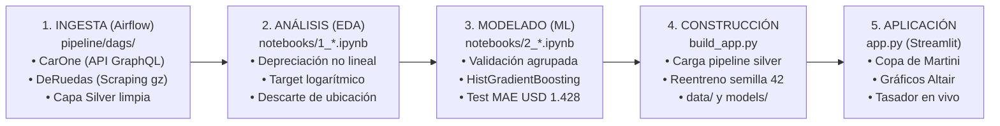

# ¿Cuánto vale tu auto? · Tasador Inteligente de Vehículos Usados

**Proyecto Integrador — Entrega 4: Repositorio Integral, Visualización y Aplicación Web**  
**Cátedra:** Ciencia de Datos · 2026 · Universidad Tecnológica Nacional (FRM)  
**Comisión y Grupo:** 5K09 - Grupo 03  
**Integrantes:**
- Garcia, Nicolás
- Ramos, Ignacio
- Velasco, Victoria
- Via, Tomás
- Nicolas, Sergio

---

## 1. Idea Central y Estructura Narrativa («La Copa de Martini»)

La aplicación web está estructurada bajo el patrón de comunicación analítica de la **Copa de Martini**:
1. **La Portada:** Plantea la pregunta disparadora del proyecto y fija la tesis central en una oración formal con sujeto, verbo y tres números cuantitativos que la sostienen:
   > *«Con once atributos mecánicos y cronológicos, el modelo estima el valor de mercado con un error relativo de 6,6 % en la mayoría de los casos, y cuando el modelo se equivoca más de lo esperado, el desvío se concentra en vehículos de alta gama valuados en dólares.»*
2. **El Tallo (guiado por el autor):** Recorre cronológicamente las tres entregas previas mediante títulos asertivos, gráficos de soporte en Altair y bloques desplegables «Cómo lo sabemos» con la evidencia técnica completa:
   - **Los datos (Entrega 1):** *«Siete marcas concentran el 75 % de la oferta y el 80 % de los autos tiene menos de 12 años»*.
   - **Lo que encontramos (Entrega 2):** *«La depreciación es exponencial: el valor cae abruptamente los primeros años y se estabiliza»*.
   - **El modelo (Entrega 3):** *«HistGradientBoosting supera al modelo lineal por más de seis desvíos y comprime el error a USD 1.412»*.
3. **La Copa (manejada por el usuario):** Brinda el control al usuario para interactuar con los datos y el modelo:
   - **Explorá tus datos:** Panorama general del mercado con zoom, filtros dinámicos (marca, años, combustible) y detalle a pedido con tooltip interactivo (precio real vs. tasación y error porcentual).
   - **Probá el modelo:** Tasador interactivo donde el usuario ingresa las características de su vehículo, recibe la tasación sugerida en USD y ARS con su margen comercial ($\pm 6,6\%$) y alertas automáticas si ingresa valores atípicos o fuera de dominio.

---

## 2. Flujo Completo del Proyecto (De la Ingesta a la Producción)

El repositorio integra y preserva el código fuente ejecutable de todo el ciclo de vida de la ciencia de datos:



### Etapa 1: Ingesta y Limpieza de Datos (`pipeline/`)
- Orquestado mediante Apache Airflow con el DAG `tp1_5K09_03_autos_mensual`.
- Recolección programada mensual de dos fuentes: CarOne (vía API GraphQL) y DeRuedas (scraping masivo de listados y páginas de detalle comprimidas en `.html.gz`).
- Normalización léxica y numérica de atributos mecánicos (`pipeline/include/autos/normalize.py`) y estructuración de esquema uniforme (`pipeline/include/autos/schema.py`).
- Consolidación en la Capa Plata (`pipeline/include/output/silver/`) deduplicando publicaciones idénticas.

### Etapa 2: Análisis Exploratorio e Hipótesis (`notebooks/1_analisis_exploratorio_entrega2.ipynb`)
- Relevamiento de asimetría positiva en el precio ($3,75$) y en el kilometraje ($33,5$).
- **Hipótesis sostenida (H1):** la depreciación temporal no es lineal. Correlación de Spearman ($r_s = 0,733$) supera ampliamente a Pearson ($r = 0,406$), con una brecha de $0,327$ (verde). Al transformar el precio a logaritmo, la correlación lineal sube a $0,600$, validando la pérdida de valor multiplicativa.
- **Hipótesis refutada (H4):** la provincia o localidad del vendedor explica apenas el 3,4 % de la varianza del precio ($\eta^2 = 0,0341$, zona roja). Se descarta `ubicacion` para evitar sobreajuste con 122 categorías ruidosas.
- **Saneamiento de anomalías (H2):** detección y exclusión del registro anómalo de 1.000 L de cilindrada, elevando la correlación entre potencia y motor a $r = 0,695$.

### Etapa 3: Modelado Predictivo y Validación Agrupada (`notebooks/2_modelado_tasador_entrega3.ipynb`)
- Definición de **MAE en USD** como métrica rectora del costo comercial lineal, con piso ingenuo de **USD 6.201,49 ± 189,46**.
- Prevención estricta de fugas de datos (*data leakage*): partición `GroupShuffleSplit` (80/20) y validación cruzada interna `GroupKFold(5)` agrupadas por la clave única vehicular (`marca|modelo|version|fabricado_en|kilometraje`), impidiendo que republicaciones del mismo automóvil se compartan entre train y test.
- Comparativa de familias en CV: modelo lineal Ridge (USD 2.143), Random Forest (USD 1.532) y HistGradientBoosting (USD 1.478).
- Ajuste de hiperparámetros con `GridSearchCV` sobre 32 combinaciones de árboles y tasa de aprendizaje: ganador `HistGradientBoostingRegressor(learning_rate=0.1, max_iter=600, max_leaf_nodes=15, min_samples_leaf=10)` con **MAE = USD 1.412 ± 105**.
- Evaluación final en Test ciego: **MAE de USD 1.428**, Error Relativo Mediano de **6,6 %** y $R^2 = 0,90$.
- Diagnóstico de errores: el error relativo se mantiene estable en 5-6 % en la gama media, y se evidencia una subestimación sistemática en autos cotizados en USD por distorsiones del tipo de cambio implícito libre.

### Etapa 4: Construcción Automatizada y Aplicación Web (`build_app.py` y `app.py`)
- `build_app.py` busca dinámicamente el archivo consolidado más reciente generado por Airflow en la capa Silver (`pipeline/include/output/silver/final_*.csv`), ejecuta el saneamiento estandarizado, entrena con la semilla original fijada (`SEMILLA = 42`) y crea automáticamente la carpeta `data/` únicamente al exportar el modelo serializado (`models/modelo_tasador.joblib`), el dataset liviano (`data/autos_app.parquet`) y las métricas precalculadas (`data/metricas_app.json`).
- `app.py` sirve la aplicación en Streamlit lista para uso público.

---

## 3. Arquitectura del Repositorio

```text
cuanto vale tu auto/
├── pipeline/                           # Código de ingeniería de datos y orquestación (Entrega 1)
│   ├── dags/
│   │   └── dag_tasador_vehiculos.py    # DAG de Airflow de extracción mensual
│   ├── include/
│   │   └── autos/
│   │       ├── collectors/             # Módulos de recolección (carone.py, deruedas.py)
│   │       ├── normalize.py            # Normalización léxica y numérica
│   │       └── schema.py               # Definición de columnas y tipos
│   ├── Dockerfile                      # Entorno contenedorizado para Airflow
│   ├── airflow_settings.yaml           # Configuración de variables y conexiones
│   └── requirements.txt                # Dependencias del pipeline de datos
├── notebooks/                          # Cuadernos interactivos de análisis y modelado
│   ├── 1_analisis_exploratorio_entrega2.ipynb  # EDA, semáforos e hipótesis (Entrega 2)
│   └── 2_modelado_tasador_entrega3.ipynb       # Validación agrupada, CV y ensamble (Entrega 3)
├── data/                               # Datos y métricas optimizadas para la aplicación
│   ├── autos_app.parquet               # Dataset vehicular procesado con predicciones
│   ├── autos_app.csv                   # Respaldo tabular en CSV
│   └── metricas_app.json               # Métricas de validación, importancia y tramos
├── models/                             # Artefactos serializados del modelo
│   └── modelo_tasador.joblib           # Pipeline completo entrenado con semilla fija 42
├── src/                                # Código fuente modular de la aplicación web
│   ├── __init__.py
│   ├── utils.py                        # Transformador IngenieriaAutos, cacheo y validadores
│   └── charts.py                       # Constructores modulares de visualizaciones Altair
├── .streamlit/
│   └── config.toml                     # Configuración de tema (#0b5d7a, #f4f5f6) y servidor
├── app.py                              # Aplicación interactiva de Streamlit (Copa de Martini)
├── build_app.py                        # Script de regeneración automatizada de punta a punta
├── requirements.txt                    # Dependencias exactas para ejecución y despliegue
├── .gitignore                          # Exclusiones de Git (Airflow logs, checkpoints, etc.)
└── README.md                           # Documentación completa y guía de defensa
```

---

## 4. Instalación y Ejecución Local

### Prerrequisitos
- Python 3.10 o superior (validado en Python 3.14).
- Gestor de paquetes `pip`.

### Paso 1: Clonar y situarse en el repositorio
```bash
cd "Proyecto Grupal/Entrega 4/cuanto vale tu auto"
```

### Paso 2: Crear y activar entorno virtual
```powershell
# En Windows (PowerShell)
python -m venv .venv
.venv\Scripts\Activate.ps1

# En Linux / macOS
python3 -m venv .venv
source .venv/bin/activate
```

### Paso 3: Instalar dependencias
```bash
pip install -r requirements.txt
```

### Paso 4: Regeneración de artefactos (Opcional)
Para reproducir el entrenamiento y recalcular las predicciones desde el dataset del pipeline:
```bash
python build_app.py
```

### Paso 5: Ejecutar la aplicación Streamlit
```bash
streamlit run app.py
```
La aplicación abrirá automáticamente en tu navegador en `http://localhost:8501`.

---
